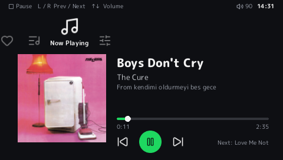
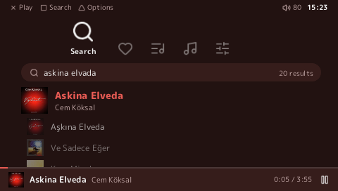

# PSPotify ME

> **Work in progress.** It plays full Spotify tracks on real hardware, but expect rough edges and missing features. See [Status](#status).

A native Spotify client for the PlayStation Portable. Everything runs on the PSP itself — no PC, phone app or proxy in the loop. The second CPU, the **Media Engine**, decodes the music while the main CPU handles the network and the interface.

- **XMB-style interface** drawn by the PSP's graphics chip at 60 fps: categories across the top, smooth lists, album covers everywhere.
- **Search**, **Recently played**, **Liked Songs** and your **playlists**.
- A **queue**: add songs with △, reorder them with SELECT; save and remove **Liked Songs** from the same menu.
- **Full tracks** (Ogg Vorbis 160 kbps), streamed: long tracks play through a small buffer instead of filling the RAM.
- **Seek** (hold L/R), **shuffle**, **repeat**, and an **equalizer that runs on the Media Engine**.
- **Themes** you can write in a text file, and **Cover colors**: the theme takes its color from the album art.
- Signs in once by pairing at **spotify.com/pair** (like a smart TV), then refreshes silently.
- **TLS 1.2** on the PSP through a bundled BearSSL: the firmware's SSL stops at TLS 1.0, and every Spotify endpoint requires TLS 1.2.

Requires **Spotify Premium**.

<p align="center">
  <a href="https://youtu.be/5UoCwZZf08E">
    
  </a>
  <br>
  <sub>▶ <a href="https://youtu.be/5UoCwZZf08E">Showcase video</a> of the new interface · <a href="https://youtu.be/Er0A1bQupJ0">first version</a></sub>
</p>

<p align="center">
  
  
</p>

<sub>Screenshots from a PSP-3000 (480×272).</sub>

## Requirements

| | |
|---|---|
| Tested consoles | PSP-1000, PSP-2000, PSP-3000 and PSP Go. The PSP-3000 is mine; the others were confirmed by volunteers. |
| Untested | PSP-E1000 (Street) and anything else. Unknown models and Media Engine images refuse safely. Hardware feedback wanted. |
| Firmware | 6.61 with ARK CFW. 6.60 is also accepted on the PSP-1000 (tested) and the PSP Go. The Media Engine bring-up refuses any other firmware. |
| Memory | Works with the default memory layout; ARK's extra-memory (highmem) option is not needed. |
| Network | A Wi-Fi profile saved in the PSP's network settings |
| Account | Spotify Premium |

## Install

1. Download `PSPotify-ME.zip` from [Releases](https://github.com/Luxotick/PSPotify-ME/releases) and copy its `PSP` folder to the root of the Memory Stick. You should end up with `ms0:/PSP/GAME/PSPOTIFY/EBOOT.PBP` and the `THEMES` folder next to it.
2. Launch **PSPotify ME** from *Game → Memory Stick*.
3. On the first start the PSP shows a six-letter code. Open **spotify.com/pair** on a phone or computer, sign in and enter the code. The approval page names the client "Spotify for Desktop"; that is expected.
4. Your library appears. Later starts skip pairing.

Updating from an older version keeps your pairing. More detail, plus troubleshooting, is in [docs/SETUP.md](docs/SETUP.md).

## Controls

| Button | In a list | On Now Playing |
|---|---|---|
| ← / → | Change category | Change category |
| ↑ / ↓ | Move (hold to scroll) | Volume |
| ✕ | Open / play | Repeat: off, queue, track |
| ○ | Back | — |
| □ | Pause / resume (in Search: type a search) | Pause / resume |
| △ | Song menu: add to queue, save to / remove from Liked Songs | Shuffle |
| SELECT | In Queue: pick a song up, then ↑/↓ to move it | — |
| L / R | Tap: previous (restarts after 3 s) / next song. Hold: seek back / forward | Same |
| START | Quit | Quit |

## Themes

Each folder in `PSP/GAME/PSPOTIFY/THEMES/` is a theme. Pick one under **Settings**. A theme is one text file, `theme.ini`:

```ini
name = Midnight
background = #0E0F13
surface = #1B1D24
text = #F2F2F2
text_dim = #9EA3AE
accent = #1ED760
```

Copy a folder, change the colors in Notepad and it shows up in Settings. A missing or malformed line keeps the default color.

**Cover colors** (Settings, on by default) tints the theme with the dominant color of the playing track's album art. A dark theme stays dark and a light one light; only the hue changes, so text stays readable.

To try themes without the PSP, the [PC preview](docs/PREVIEW.md) reloads `theme.ini` the moment you save it.

## How it works

```
                        main CPU (Allegrex, 333 MHz)                         Media Engine
 ┌────────────────────────────────────────────────────────────────────┐   ┌───────────────┐
 │ UI thread       XMB interface ── sceGu (graphics chip), 60 fps     │   │               │
 │ loaders         lists, search, covers ── spclient / i.scdn.co      │   │  stb_vorbis   │
 │ player thread   metadata → audio key (AP) → storage-resolve        │   │  frame decode │
 │ fetch thread    CDN download → AES-128-CTR decrypt → stream ring ──┼──►│  + equalizer  │
 │ keepalive       AP pings, next-track prefetch                      │   │  → s16 PCM    │
 │ audio out       PCM ring ◄─────────────────────────────────────────┼───┤               │
 └────────────────────────────────────────────────────────────────────┘   └───────────────┘
```

1. **Sign-in.** The PSP pairs once through Spotify's OAuth device flow and keeps the refresh token. The access token logs in to Spotify's access point (Shannon-encrypted, Diffie-Hellman handshake). The access point returns reusable credentials. Those credentials get a login5 Bearer token for Spotify's internal services.
2. **Library.** Playlists come from the rootlist service, Liked Songs from the collection service, recently played from the recently-played service, and search results from context-resolve. Names, artists, durations and covers come from batched extended-metadata requests. Lists load on a background thread, so the interface never waits for the network.
3. **Playback.** For each track the player:
   - picks the Ogg Vorbis 160 kbps file,
   - requests its AES key over the access point,
   - resolves a CDN URL,
   - downloads the file on a background thread, decrypting each chunk as it arrives.

   A file that does not fit in memory streams through a 3 MB ring. Seeking jumps inside the buffer, or restarts the download at the right byte with an HTTP range request. The next track is resolved ahead of time.
4. **Decoding.** Each Vorbis frame is handed to the Media Engine through mcidclan's safe-task dispatcher. A small assembly trampoline gives the task its own stack and enables the FPU. The Media Engine decodes the frame, runs the equalizer (five peaking filters) and writes s16 PCM back to shared memory; the main CPU queues it to the audio hardware. A build check fails if any code that runs on the Media Engine uses `syscall` or `$gp`.
5. **Interface.** The XMB-style interface in `ui/` does not depend on the PSP: it draws through a small set of primitives, implemented with sceGu on the PSP and with SDL in the PC preview. Text is rendered from the M PLUS Rounded 1c font with stb_truetype; the fonts are cut down to the characters the app uses at build time.

[docs/IMPLEMENTATION.md](docs/IMPLEMENTATION.md) covers the Media Engine protocol and its cache rules.

## Status

Works on hardware: pairing, the XMB interface, Liked Songs, playlists, search, recently played, covers, Cover colors and themes, full-track playback with Media Engine decoding, seeking, shuffle, repeat, the equalizer, pause, next/previous and volume. The queue and Liked Songs editing are new and still need wider testing.

Confirmed on the PSP-1000, PSP-2000, PSP-3000 and PSP Go, thanks to volunteers with hardware I don't have.
The app logs device, firmware and Media Engine image information before it starts the Media Engine.
BL, SD, unknown images, partial inspection failures and unsupported firmware refuse before any Media Engine patching or AVCODEC loading.

### Known issues

- **New interface on other models:** the new interface has been tested on a PSP-3000 only. It uses a little more memory, which matters most on the 32 MB PSP-1000. Logs from other models are welcome.
- **Liked Songs:** a large Liked Songs list can take a while to load completely when Spotify's servers are slow. It fills in 120 songs at a time, and opening a playlist or searching does not wait for it.
- **Slow failures:** after a refused key the app reconnects to Spotify before giving up on the track. That wastes about 1.5 s per track and rewrites `spotify.cfg` each time.
- **Region-restricted tracks:** when Spotify replaces a track with an alternative version, the key is still requested with the original track's ID. Those tracks may fail even on Premium.
- **PSP Go internal storage:** the PSP Go was tested from a Memory Stick Micro. Running from internal storage should work but has not been tested.

### TODO

- **Spotify Connect** (control the PSP from the Spotify apps): work in progress on the [`wip/spotify-connect`](https://github.com/Luxotick/PSPotify-ME/tree/wip/spotify-connect) branch.
- Add songs to playlists.
- Keep queued songs when you start another list.
- Search for artists, albums and playlists, not only songs.
- Reconnect only on network errors, not when Spotify refuses a key.
- Request keys for alternative tracks with the alternative's ID.

### Limitations

- **Library limits:** up to 100 playlists and 500 songs per list; search shows up to 50 songs.
- **Text:** Latin letters, including Turkish and most European accents, display properly. Other scripts (Cyrillic, Greek, Japanese, …) show `?`.
- **Errors:** a track that fails to play is skipped, and the screen says why (no Premium, not enough memory, no playable file). After three failures in a row playback stops.
- **Long sessions:** sessions longer than an hour, which need token renewal, have had little testing.

The app keeps quiet by default and writes no log. To get one for a bug report, set `debug = on` in `settings.ini` (next to the EBOOT) and start the app again; it then writes `spotify.log` next to the EBOOT. Bug reports with that file attached are very welcome.

## Contributing

Contributions of any size are welcome: bug reports, fixes, features, themes, testing on other models.

There is one rule for pull requests: **write the description yourself.** Using AI tools while coding is fine. But the PR text must be your own words, explaining what you changed and why. You should be able to answer questions about your change. I want to talk to the person behind the code. See [CONTRIBUTING.md](CONTRIBUTING.md).

## Building

The build needs PSPDEV, Python 3.8+ with `fontTools`, CMake and Git. With `PSPDEV` set:

```sh
python3 scripts/build.py
```

The build script:
- fetches the pinned dependencies into `.deps/` (Media Engine custom core and safe task, BearSSL, stb, the fonts and icons),
- cuts the fonts down to the characters the app uses,
- builds the EBOOT,
- runs the static checks in `scripts/verify_artifacts.py`,
- puts the installable layout in `dist/`.

GitHub Actions does the same on every push, using the `pspdev/pspdev` container.

The interface also builds as a PC program with mock data, for working on layout and themes without the PSP: `python scripts/build_preview.py` (Windows with Visual Studio, or Linux with SDL2). See [docs/PREVIEW.md](docs/PREVIEW.md).

## Layout

| Path | Contents |
|---|---|
| `main.c`, `me_loop.c` | Media Engine bring-up, network start, teardown |
| `ui/` | The XMB interface: screens and animation, fonts, themes, Cover colors (platform-independent) |
| `spotify/ui.c`, `render_gu.c` | The interface on the PSP: library loading, covers, settings, sceGu drawing |
| `spotify/session.c` | Sign-in, tokens, access point keepalive, track resolution and prefetch |
| `spotify/player.c`, `me_vorbis.c`, `me_trampoline.S` | Download, decryption, seeking and the Media Engine decode and equalizer |
| `spotify/webapi.c` | clienttoken, login5, OAuth, metadata, storage-resolve, library, search, recently played |
| `spotify/handshake.c`, `login.c`, `shannon.c`, `dh.c`, `audiokey.c` | Access point protocol |
| `spotify/http.c`, `tls.c`, `trust_anchors.h` | HTTP/1.1 client (with keep-alive) and TLS 1.2 (BearSSL) |
| `spotify/connect.c` | Spotify Connect (built in, switched off; work in progress) |
| `tools/preview/` | The PC preview (SDL2) |
| `themes/` | The bundled themes |
| `certs/`, `scripts/gen_trust_anchors.py` | Bundled root certificates and the generator |

## Security notes

- `spotify.cfg` holds a refresh token and reusable credentials in plain text. Anyone with the Memory Stick can use your account. To revoke access, remove "Spotify for Desktop" under *Account → Apps* on spotify.com.
- Server certificates are verified against the bundled roots. The PSP clock must be roughly correct.

## Credits

- [mcidclan](https://github.com/mcidclan): [psp-media-engine-custom-core](https://github.com/mcidclan/psp-media-engine-custom-core) and [psp-media-engine-safe-task](https://github.com/mcidclan/psp-media-engine-safe-task) (MIT). They make running code on the Media Engine possible.
- [BearSSL](https://www.bearssl.org/) by Thomas Pornin (MIT).
- [stb_vorbis, stb_image and stb_truetype](https://github.com/nothings/stb) by Sean Barrett (public domain / MIT).
- [M PLUS Rounded 1c](https://github.com/coz-m/MPLUS_FONTS) by the M+ Project Authors (SIL Open Font License) and the [Lucide](https://lucide.dev) icons (ISC).
- [librespot](https://github.com/librespot-org/librespot): the reference for Spotify's protocols.
- [Sonora](https://github.com/sonorahq/sonora): the idea for Cover colors and the context-resolve approach to search (ideas only; no code was taken).
- [SDL2](https://www.libsdl.org/) (zlib license), for the PC preview only.
- The first interface and its layout came from my earlier [PSPotify](https://github.com/Agalar-Development/PSPotify) MP3 player.

Third-party license texts are in [`licenses/`](licenses).

## Disclaimer

This is an unofficial hobby project. It is not affiliated with, endorsed by or supported by Spotify. It talks to Spotify's private services, which can change or block it at any time. It does not save or export audio. Use it at your own risk and in line with Spotify's terms.
